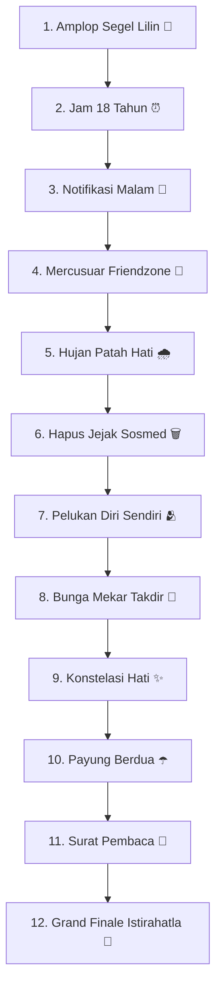

# Rencana Implementasi: Web Animasi Romantis Interaktif "Jika Kita Tak Pernah Jatuh Cinta" 💔✨
*(12 Babak Mini-Game Animasi — Bukan Buku)*

---

## 🎯 1. Konsep (REWRITE TOTAL)

Proyek ini **DIUBAH TOTAL** dari "buku 3D 45 bab" menjadi **web animasi interaktif 12 babak** — mengikuti pola sukses project sebelumnya: `rahasia-hati`, `samudra-rasa`, `kisah-kita`.

**Bukan**: cover buku, page-flip, daftar isi 45 bab, scrubber.  
**Tapi**: fullscreen scene, tiap babak = satu micro-interaction animasi (tap, hold, drag, scratch), partikel ambient, musik, kembang api finale.

- **Folder**: `/Users/andri.dev.code/Coding/Html/jika-kita-jatuh-cinta/`
- **File**: `index.html`, `style.css`, `script.js` (vanilla JS, no framework)
- **Mobile-first**: viewport-fit, touch target ≥48px, GPU CSS animasi

---

## 🎨 2. Palet Warna (Vintage Romantic Night)

| Unsur | Kode | Peran |
| :--- | :--- | :--- |
| Midnight Rose | `#1a0b14` & `#2d1220` | Background malam romantis |
| Dried Rose | `#b85d68` & `#d47b85` | Aksen cinta, mawar, hati |
| Gilded Gold | `#e6c35c` & `#cda134` | Cahaya lilin, tepi emas, sparkle |
| Warm Parchment | `#fcf8ef` & `#f4ecd8` | Kartu perkamen, teks quote |
| Sepia Ink | `#2d201a` & `#4a382d` | Tinta narasi |
| Candlelight | `#ffecd2` & `#f6d365` | Pendaran lilin ambient |

---

## 🗺️ 3. Alur 12 Babak

### Rincian Gameplay tiap Babak:

1. 💌 **Amplop Segel Lilin** — Klik amplop → segel lilin pecah → surat pembuka terbuka (typewriter quote).
2. ⏰ **Jam 18 Tahun** — Tap jam berulang → jarum berputar penuh → quote "kapankah giliranku?" muncul.
3. 📱 **Notifikasi Malam** — 5 pesan chat muncul satu per satu saat tap layar (typewriter), reaksi emoji.
4. 🗼 **Mercusuar Friendzone** — Tekan-tahan tombol 2 detik → mercusuar menyala → beam berputar.
5. 🌧 **Hujan Patah Hati** — Tangkap 8 tetes hujan yang jatuh di canvas (klik/tap).
6. 🗑 **Hapus Jejak Sosmed** — Drag 3 kartu foto ke tong sampah (hapus jejak digital).
7. 🫂 **Pelukan Diri Sendiri** — Tap hati 25× → progress ring penuh → pesan self-love muncul.
8. 🌸 **Bunga Mekar Takdir** — Tap kuncup 6× → kelopak mekar satu per satu → bunga penuh.
9. ✨ **Konstelasi Hati** — Tap 5 bintang berurutan → garis menyambung → konstelasi hati jadi.
10. ☂️ **Payung Berdua** — Drag payung ke atas 2 figur sebelum hujan turun (drag sederhana).
11. 📜 **Surat Pembaca** — Textarea tulis surat/doa → simpan ke localStorage.
12. 🌙 **Grand Finale** — Kembang api canvas + kartu penutup "Istirahatlah…" + tombol Ulangi + link WhatsApp.

---

## 🛠️ 4. Struktur Teknis (pola sama dgn samudra-rasa/rahasia-hati)

- **Engine**: `STATE` object + `nextScene()` + `onSceneEnter(n)` + `updateProgress(n)`
- **UI chrome**: `#ambient-canvas` (partikel), `#music-pill`, `#step-dots` + `#step-label` (1/12), `#toast`
- **Audio**: Web Audio API — SFX sintetis (chime, tap, pop, rain) + loop synth piano romantis (tanpa file mp3 eksternal)
- **Haptic**: `navigator.vibrate` pada aksi sukses
- **Floaters**: emoji hati/kelopak naik saat transisi
- **Finale**: `#finale-canvas` kembang api + `restartJourney()`
- **localStorage**: progres scene + surat pembaca

---

## 🧪 5. Verifikasi

1. Buka `index.html` → scene 1 aktif, musik pill muncul
2. Setiap babak: micro-interaction bisa diselesaikan di HP (tap/hold/drag)
3. Progress dots update `1/12` … `12/12`
4. Finale: kembang api jalan, restart reset semua state
5. Surat pembaca tersimpan di localStorage
